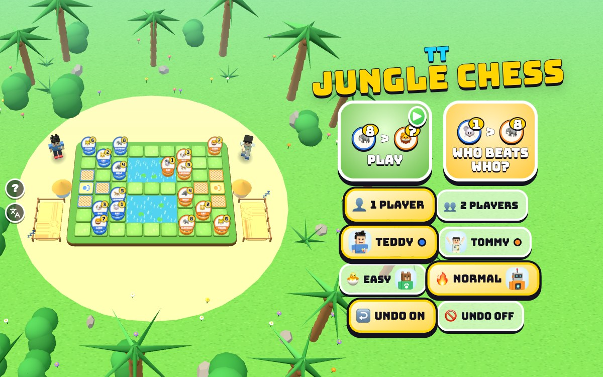

# TT Jungle Chess

[](https://adong.github.io/jungle-chess-tt/)

Press **?** any time (or tap the round **?** button on the left edge) to see the keys. The game waits while you look.
Tap the language button under it (the A文 icon) to switch between English and 中文; the dashboard and every game remember the choice.

Jungle chess on a 3D jungle board, Teddy's blue animals against Tommy's orange ones: the elephant beats the lion, the lion beats the tiger... and the little rat beats the elephant. 1 player against the CPU, or 2 players on one device.

**中文：** 丛林里的 3D 斗兽棋，Teddy 的蓝色动物对 Tommy 的橙色动物：象吃狮，狮吃虎……小小的鼠能吃象！单人对电脑，或者两人一起玩。

The classic Chinese board game 斗兽棋 starring Teddy and Tommy, built with Claude Code from plain JavaScript and Three.js on the shared Claude Games kit. The board is a chunky earth tray in a sandy jungle clearing, with two rivers, rope-net traps, a little straw hut behind each den, and a napping pen at each end. There are no image, model or audio files: the boys are the kit's blocky characters, every texture is painted on a canvas, and every sound is synthesised.

The name is a working title. It lives in one constant, `JC_TITLE` in `js/title.js`, and the page title, the logo and the ? panel read it from there.

## Play

- **Double-click `index.html`.** It works offline because Three.js and the kit are copied into `kit/`. Without internet the title font falls back to Arial Black.
- **Send one file:** `dist/jungle-chess-tt.html` is the whole game in one page. AirDrop or email it, then open it in a browser.
- Rebuild that file after any edit: `python3 kit/tools/bundle.py . --name jungle-chess-tt`

### A game

- **Teddy's side is blue and Tommy's side is orange.** In 1 player you pick which brother you are and play a friend from the kit: **🐣 EASY is Bruno the bear** (the default for Tommy), **🔥 NORMAL is Bolt the robot** (the default for Teddy). Each brother's level is remembered. In 2 players Teddy and Tommy take turns on one device.
- **The camera looks from your end.** On a tall screen (a phone held upright, an iPad) you look up the board from behind your den. On a wide screen you see it from the side, with your den on the left. Each boy stands at his end, beside his hut.
- **Tap an animal** to pick it up. It floats and wiggles, and the squares it can go to light up: green dots for a step, light blue dots for a swim, a red ring and a 💥 over an animal it can bonk, a dotted arc for a lion or tiger jump over the river, a ⚠️ over the enemy's trap (you'd be 0 there) and a 🏆 over their den. Tap a lit square to move, or tap another of your animals to swap.
- **Tap a square it can't go to** and it tells you why: TOO BIG TO BONK!, ONLY THE RAT CAN SWIM!, THE ELEPHANT CAN'T BONK THE RAT!, CLIMB OUT OF THE WATER FIRST!, HE'S SAFE IN THE WATER!, A RAT IS IN THE WAY!, NOT YOUR OWN DEN!
- **A capture** is a silly **BONK!** (a big one shakes the camera), and the beaten animal spins through the air back to its side's **napping pen** at the end of the board, where it lies down and snores 💤. Nobody gets hurt.
- **The last move** stays marked: a soft yellow glow on both squares and a 🐾 where it came from. The 🐾 over a boy's head shows whose turn it is.
- **↩️ Undo** takes back your last move (and the CPU's answer, in 1 player; one move in 2 players). It works after a game is over too, and the result comes off the score. Switch it off on the home screen (UNDO OFF) for a real game.
- **A win:** the winner does his signature move (Teddy's boxing combo or 🏀 jump shot, Tommy's Y with peace fingers ✌️; Bruno and Bolt wave), the loser shrugs, confetti falls when a kid wins, then **PLAY AGAIN**. The score at the top keeps running until you change who plays or the level. Whoever didn't start the last game starts the next one (you start the first).
- **🐭 > 🐘** at the top (or 📖 on the pause screen) opens the rules with pictures: **WHO BEATS WHO?**

## Rules

The board is 7 squares wide and 9 long. In the middle are two rivers, each 2 × 3 squares of water. At each end is a den (兽穴), with three traps (陷阱) round it.

**The animals, strongest first** (each side has one of each, and the number is on every piece):

| | | | | | | | |
|---|---|---|---|---|---|---|---|
| 8 🐘 Elephant 象 | 7 🦁 Lion 狮 | 6 🐯 Tiger 虎 | 5 🐆 Leopard 豹 | 4 🐺 Wolf 狼 | 3 🐶 Dog 狗 | 2 🐱 Cat 猫 | 1 🐭 Rat 鼠 |

- **Start:** the standard layout. From each player's side: lion and tiger in the back corners, dog and cat one row up, and the front row rat, leopard, wolf, elephant (turned round for the other side).
- **Move** one square up, down, left or right.
- **Bonk** (capture) an enemy animal with the same number or a smaller one by moving onto it.
  - **The rat beats the elephant**, but the elephant can't beat the rat.
  - The rat can't bonk the elephant straight out of the water.
- **Water:** only the rat can swim. A rat in the water can't be bonked by animals on land, and from the water he can't bonk anyone on land. He can bonk the other rat in the water.
- **Jumps:** the lion and the tiger jump straight over a river, along a row or a column, to the first square of land on the other side (and can bonk an animal there). A rat in the water anywhere on the way, either side's, blocks the jump.
- **Traps:** an enemy animal standing in one of **your** traps is 0, so any of your animals can bonk it (even your elephant can bonk a rat there). Your own traps don't change your animals.
- **Dens:** you can't go into your own den. **Walk into the enemy den and you win.** You also win if you bonk all their animals, or they have no move left.
- **Too long:** if nobody has won after 240 moves in all (120 each), it's a draw. The last 20 show a countdown under the score.

## Controls

| | Keys | Touch |
|---|---|---|
| pick up your animal by its number (1 rat … 8 elephant) | 1 – 8 | tap it |
| move round the board · pick up or put down | ← ↑ → ↓ · Enter or Space | tap a glowing square |
| put the animal back | Esc | tap it again |
| undo your last move | U or Backspace | ↩️ |
| call your brother (2 players: high five) | T | his face, bottom right (🙌 in 2 players) |
| who beats who? (the rules) | R | 🐭 > 🐘 |
| new game | N | 🔄 on the pause screen |
| pause · sound | P or Esc · M | ⏸️ · 🔊 |
| menu: play · Teddy or Tommy · 1 or 2 players | Enter · ← → · ↑ ↓ | the buttons |
| menu: level · undo on or off | L · U | the buttons |

- **The arrow keys** move the yellow cursor the way they point on the screen, whichever way the camera looks.
- **Undo and the rules button** sit at the bottom left on a tall screen and next to pause on a wide one.

## Call your brother (companion mode)

**1 player:** the CPU is a friend from the kit, so your brother is free to help. Call him with **T** or by tapping his face (bottom right), **any time and as often as you like** (`Kit.roster.buddyFor`: Tommy for Teddy, Teddy for Tommy).

- **He pops in** beside you in a puff of stars, at his roster `buddyScale`, with his name tag.
- **He says hi** with his signature move (Tommy's Y with ✌️, Teddy's boxing combo) and **tosses you a treat** (🍦 💧 🧃 🍪 🍉 🍌) that arcs into your hand: "🍪 COOKIE FROM TOMMY!"
- **Then he protects you with a hint.** He turns and points: the animal to move glows, the square to move it to glows gold with a bouncing 👇, and a toast says what to do:
  - "TOMMY SAYS: GO IN THE DEN!" or "BONK THE CAT AND WIN!" when you can win right now;
  - "GUARD YOUR DEN!" when the CPU could walk into your den next move;
  - "YOUR LION IS IN DANGER!" (with a ❗ over it) when one of your animals can be bonked next move and this saves it;
  - "BONK THE WOLF!" for a good capture;
  - "MOVE THE RAT!" otherwise.
  He looks 4 moves ahead (Bolt on 🔥 NORMAL looks 2), so his tips are good on both levels. If it's the CPU's turn when he arrives, he waits for yours.
- **Once you've moved** he does his goodbye move and pops out. Call him again while he's there and he says hi again, brings another treat and points again.

**2 players:** both brothers are already at the board, so **T** (or 🙌) is a **high five**: they run to meet beside the board, slap hands (💥) and run back. It doesn't change the game.

## Make it yours

- `js/title.js`: the game's name.
- `js/rules.js`, near the top: `LIMIT` (the draw rule), `EASY` (how often Bruno takes an open den, a capture, dodges a bonk or heads for your den), `NORMAL` (how far Bolt looks ahead) and `HINT` (how far your brother looks).
- `js/game.js`, top: `CPU` (who plays each level), `SCALE` (the boys' size).
- `js/stage.js`: the jungle, the board, the pieces' badges, the pens, colours (`COL`).

## How it works, and how it's tested

- `js/rules.js` has no Three.js and no page in it: the board, the rules, the CPU and the hint. The same file runs the game and the headless checks.
  - Squares are numbered row × 7 + column from orange's end; a square holds 0 or side × 8 + rank, so the number is also the piece.
  - 🔥 NORMAL is a negamax search with alpha-beta, 2 moves deep (its move and your answer), then follows any captures to the end of the swap. It scores a board by the animals' values and how close each is to the enemy den, with a little randomness so games differ.
  - 🐣 EASY mostly wanders: it takes an open den 6 times in 10, a capture a bit under half the time, only sometimes notices that a square would get it bonked, and now and then heads for your den.
- `js/game.js` runs the game and turns each move into the hop, jump or swim, the BONK and the trip to the pen, the sounds and the boys' reactions.
- Console hooks (`window.game`):

```js
game.start({ players: 1, who: 'tommy', level: 'easy', undo: true })   // straight into a game
game.tapAt(6, 6)         // tap the square at column 6, row 6 (row 0 is orange's end) for the kid whose turn it is
game.call()              // call your brother (2 players: high five)
game.undo()              // undo
game.step(2)             // advance 2 s and draw (when the browser tab's animation is throttled)
game.hold(true)          // freeze the live loop, so only game.step() moves time
game.auto(true, 'easy')  // a test bot plays the kid's side too
game.setup([[0, 7, 1, 6], [1, 3, 1, 2]], 0)   // a board with just these pieces: [side, rank, col, row]
game.check()             // the headless checks below (4 games per pairing; game.rates() for the win rates)
game.info()              // state, turn, scores, the brother, the hint
```

The same checks run from a terminal with Node:

```bash
node tools/check.js 50
```

```bash
node tools/check.js 10 --sabotage elephantrat
```

```bash
node tools/check.js rates
```

- **Every rule, on little boards set up for it** (58 checks): the start position (both sides the same, the standard squares, 12 water squares); the rat beats the elephant and the elephant can't beat the rat; equal ranks, bigger and smaller; the water rules (only the rat swims, along and out, no catching from the water onto land, the elephant safe from a swimming rat, a land animal can't catch a swimming rat, rat on rat in the water); the lion and tiger jumps in both directions along rows and columns, blocked by a rat of either side, landing on smaller, bigger and own pieces, and that no other animal jumps; traps (theirs make you 0, your own don't, even the elephant takes a rat in his trap); your own den is closed, walking into theirs wins (for both sides), catching the last animal wins, no move left loses, the draw at 240; illegal moves change nothing; and the hint on four boards (the den win, a lion in danger, guarding the den, a capture).
- **CPU games:** 🔥 NORMAL against 🐣 EASY, EASY against EASY, random against random, a kid-like bot against EASY, a greedy bot against NORMAL and NORMAL against itself, both colours, both starting. Every move is checked legal, every game must end (by 240 moves), and NORMAL must beat EASY at least 3 times in 4.
- **It can fail:** each `--sabotage` switches one rule off and the check fails: `elephantrat` (the elephant may take the rat), `ratwater` (the rat may bonk from the water), `nojumpblock` (rats don't block jumps), `notrap`, `owntrap` (your own trap makes you 0), `ownden` (you may walk into your own den), `nolimit` (no draw rule: some games never end), and `blind` (NORMAL plays at random and stops beating EASY).
- **At the last check** (`node tools/check.js 50`, 7 seconds): 58 of 58 rules; NORMAL beat EASY 98 times in 100 (every game ended in a den); 312 games, every move legal, every game ended, the longest at the 240-move draw.
- **Win rates with bots** (`node tools/check.js rates`). Not a pass or fail check; it's how the levels were tuned:
  - 🐣 EASY: a kid-like bot (walks into the den when it sees it, likes bonking, heads for the den half the time, sometimes looks before it steps) wins about 3 in 4 (78 in 100). A bot that moves at random wins 4 in 100 (and draws 1 in 10). A greedy bot (one move ahead) wins 9 in 10.
  - 🔥 NORMAL: a careful older-kid bot (looks 2 moves ahead, but one move in five just plays along) wins about 1 in 3 (32 in 100); the kid-like, greedy and random bots almost never win. Bolt first looked 4 and then 3 moves ahead, and the careful bot won only 3 to 15 games in 100, so he looks 2 now. Your brother's hints look 4 moves ahead, so calling him makes you stronger than Bolt.
- **The browser:** whole games through the real renderer (`game.auto`) to PLAY AGAIN with no console errors, 1 player as Teddy and as Tommy and 2 players; the brother's visit and hint, the high five, undo (including a capture coming back out of the pen), the keyboard (number keys, arrows in the turned camera, Enter, Esc, U, R). 中文: every screen visited (home, rules, the ? panel, play, the brother, pause, game over, 2 players) and every toast, burst and badge name, and `Kit.lang.untranslated()` stayed `[]`; a planted page string and a planted canvas word were both caught. English: no Chinese anywhere except the kit's language button tooltip. Layouts checked by screenshot: 800×600, iPad 768×1024, phone upright 390×844, phone on its side 740×360.

## Files

```
index.html               page, HUD, menus, panels, the rules screen (CSS inline)
js/title.js              the game's name (one constant)
js/rules.js              the rules, the CPU levels and your brother's hint (no Three.js)
js/check.js              the headless checks, the test bots and the win-rate report (game.check, game.rates, tools/check.js)
js/stage.js              the jungle, the board, the animals' pucks and badges, moves, bonks, the pens, highlights, the camera fit, picking
js/actor.js              a boy at his end of the board: poses, reactions, treats (from TT Tic-Tac-Toe)
js/buddy.js              your brother's visit and hint, and the 2-player high five
js/fx.js                 emoji flyers, word bursts, confetti
js/sfx.js                game sounds on top of Kit.sound
js/game.js               the game, turns, undo, the CPU's timing, the score, screens, input, main loop, window.game hooks
js/keys.js               the keys the ? panel shows (Kit.help)
js/zh.js                 中文 for every word the player sees (Kit.lang); names and the game's name stay English
tools/check.js           runs the headless checks under Node
kit/                     copy of ~/claude-games/kit (python3 ../kit/tools/sync.py .), never edited here
dist/jungle-chess-tt.html  the single-page build
```

## Not verified

- **Sound:** the synth code runs without errors, but nobody listened to it.
- **Real touch devices:** tapping was checked in the browser's phone and tablet sizes, but no real phone or iPad was used. A tap on an animal's round badge picks that animal; a tap on the grass picks the square.
- **Real kids:** the levels are tuned with test bots. Whether 🐣 EASY is right for Tommy and 🔥 NORMAL for Teddy needs Tommy and Teddy. `EASY` and `NORMAL` in `js/rules.js` are the knobs.
- **Speed on an older iPad:** Bolt's search takes a few milliseconds on a Mac; your brother's 4-move hint up to about 150 ms. Not timed on a real iPad.
- **Double-click from Finder:** `index.html` and `dist/jungle-chess-tt.html` were opened from `file://` in headless Chrome, not by double-clicking in Finder.
- **The iPad home-screen icon:** the apple-touch-icon is drawn by script like the siblings'; nobody added it to a real iPad.
